 

  

## About Me

Software engineering student at **Université SESAME** with a strong focus on **web development** and building modern, responsive applications. I enjoy turning ideas into clean, functional code and I am always eager to learn new technologies.

- Engineering student in Computer Science at **Université SESAME**
- Full-stack development with **Django, Laravel, Spring Boot, React, Angular and Vue**
- Interested in **DevOps, CI/CD, Docker and cloud deployment**
- Exploring **data engineering and BI** with SQL Server, SSIS, Power BI and Metabase
- Currently deepening my knowledge of **AI, microservices and clean architecture**
- Based in Tunisia

## Tech Stack

<picture>
  <source media="(prefers-color-scheme: dark)" srcset="https://skillicons.dev/icons?i=python,java,cs,php,typescript,javascript,django,laravel,spring,react,angular,vue,tailwind,mysql,postgres,mongodb,docker,git,github,linux,azure,netlify&theme=dark&perline=11" />
  <source media="(prefers-color-scheme: light)" srcset="https://skillicons.dev/icons?i=python,java,cs,php,typescript,javascript,django,laravel,spring,react,angular,vue,tailwind,mysql,postgres,mongodb,docker,git,github,linux,azure,netlify&theme=light&perline=11" />
  
</picture>

  

 

## Featured Projects

<table>
  <tr>
    <td width="50%" valign="top">
      <h3><a href="https://github.com/lotfi7021/stage-ete-piece-de-rechange">SD-Auto · Pièces de rechange</a></h3>
      
Automotive spare-parts e-commerce platform: product catalog, order management, stock tracking, invoicing, after-sales service and admin dashboards. Built with SCRUM.

      

        
        
        
      

      

    </td>
    <td width="50%" valign="top">
      <h3><a href="https://github.com/lotfi7021/SESAME-CONNECT">SESAME-CONNECT</a></h3>
      
Student announcements platform for publishing and managing campus updates with a clean Django backend.

      

        
        
        
      

      

    </td>
  </tr>
  <tr>
    <td width="50%" valign="top">
      <h3><a href="https://github.com/lotfi7021/projet_micro_service">Projet Microservices</a></h3>
      
Microservices-based application with a modern, component-driven front-end.

      

        
        
      

      

    </td>
    <td width="50%" valign="top">
      <h3><a href="https://github.com/lotfi7021/devops">DevOps Backend</a></h3>
      
DevOps-oriented backend project with Maven build automation and a Spring Boot foundation.

      

        
        
        
      

      

    </td>
  </tr>
  <tr>
    <td width="50%" valign="top">
      <h3><a href="https://github.com/lotfi7021/Architecture-N-Tiers">Architecture N-Tiers</a></h3>
      
Layered N-tier application demonstrating clean architecture and separation of concerns.

      

        
        
      

      

    </td>
    <td width="50%" valign="top">
      <h3><a href="https://github.com/lotfi7021/L-orchestration-avec-Docker-Compose">Docker Compose Orchestration</a></h3>
      
Multi-container environment orchestrated with Docker Compose to practice service isolation and networking.

      

        
        
        
      

      

    </td>
  </tr>
  <tr>
    <td width="50%" valign="top">
      <h3><a href="https://github.com/lotfi7021/portfolio">Portfolio</a></h3>
      
Personal portfolio website with a modern, animated interface and a dark visual identity.

      

        
        
        
        
      

      

    </td>
    <td width="50%" valign="top">
      <h3><a href="https://github.com/lotfi7021/achat">Achat</a></h3>
      
Purchasing and e-commerce application built in Java.

      

        
      

      

    </td>
  </tr>
  <tr>
    <td width="50%" valign="top">
      <h3><a href="https://github.com/lotfi7021/boumiza">Boumiza</a></h3>
      
TypeScript web project exploring modern front-end tooling and component design.

      

        
      

      

    </td>
    <td width="50%" valign="top"></td>
  </tr>
</table>

## Certifications

| Certification | Issuer | Date |
| :--- | :--- | :--- |
| Microsoft Certified: Azure Data Fundamentals (DP-900) | Microsoft | Dec 2025 |
| Building Transformer-Based Natural Language Processing Applications | NVIDIA | Apr 2026 |
| IT Specialist — Artificial Intelligence | Certiport (Pearson VUE) | 2026 |

## GitHub Stats

  

  

  

## Contribution

<h3>Snake</h3>

<picture>
  <source media="(prefers-color-scheme: dark)" srcset="https://raw.githubusercontent.com/lotfi7021/lotfi7021/output/github-snake-dark.svg" />
  <source media="(prefers-color-scheme: light)" srcset="https://raw.githubusercontent.com/lotfi7021/lotfi7021/output/github-snake.svg" />
  
</picture>

Generated daily with <a href="https://github.com/Platane/snk">Platane/snk</a> and GitHub Actions.

  

<h3>3D Contribution Calendar</h3>

<picture>
  <source media="(prefers-color-scheme: dark)" srcset="https://raw.githubusercontent.com/lotfi7021/lotfi7021/output-3d-contrib/night.svg" />
  <source media="(prefers-color-scheme: light)" srcset="https://raw.githubusercontent.com/lotfi7021/lotfi7021/output-3d-contrib/day.svg" />
  
</picture>

Generated daily with <a href="https://github.com/yoshi389111/github-profile-3d-contrib">github-profile-3d-contrib</a>.

## Contact

Software engineering student open to a **PFE internship**, collaboration and interesting projects.

  

  

  

 

  

